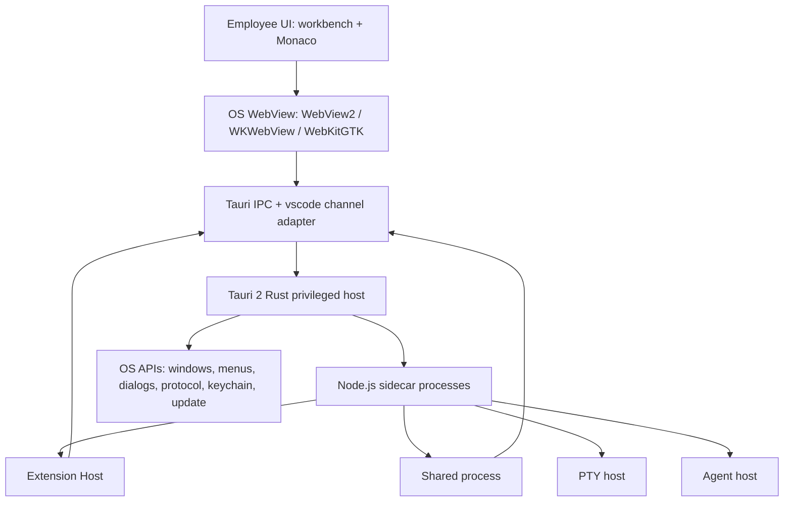

# Lightweight Desktop Runtime

Feature Name: lightweight-desktop-runtime
Updated: 2026-10-10

## Description

Replace the Electron desktop shell in this Code - OSS fork with Tauri 2, while keeping the existing TypeScript workbench, editor, Extension API, CLI, and server stacks. The privileged host becomes a Rust binary. Workbench UI renders in the OS webview. Extension Host, shared process, PTY host, and agent host keep running on a shipped Node.js sidecar so the full extension ecosystem, including native Node addons, continues to load.

Employee-facing desktop capabilities stay at the Compatibility Baseline. Windows, macOS, and Linux ship in the same release train. Each platform installer is at most 20 percent of the Compatibility Baseline installer. Idle Memory is at most 50 percent of the Compatibility Baseline Idle Memory.

Migration is staged. Maintainers first extract `desktop-main` / `desktop-browser` / `desktop-utility` and keep Electron as a second backend. Tauri becomes the employee default only after capability and budget gates pass. The installer bundles one Node.js runtime aligned to the current Electron ABI. Simple Browser renders in an extra OS webview; CDP-only automation stays available only when that webview exposes an equivalent protocol.

## Architecture

The current desktop product is a layered TypeScript application hosted by Electron:

- Privileged process: `src/mainImpl.ts`, `src/vs/code/electron-main/`
- Workbench renderer: `src/vs/code/electron-browser/`, `src/vs/workbench/electron-browser/`
- Utility / shared / PTY / agent processes: `src/vs/code/electron-utility/`, `src/vs/platform/utilityProcess/electron-main/`
- Native OS facade: `src/vs/platform/native/electron-main/nativeHostMainService.ts` implementing `ICommonNativeHostService`
- Packaging: `build/lib/electron.ts`, `build/gulpfile.vscode.ts`, `@vscode/gulp-electron`

The replacement keeps every `common`, `browser`, and `node` contract. It swaps the desktop-host implementations and the packaging pipeline.



Process mapping:

| Compatibility Baseline | Lightweight Desktop Runtime |
| --- | --- |
| Electron main | Tauri 2 Rust privileged host |
| Electron renderer / Chromium | OS webview loading the existing workbench bundle |
| Electron preload + `vscode:` IPC | Tauri command/event bridge that preserves `vscode:` channel names at the TypeScript boundary |
| Electron utility process | Node.js sidecar child process |
| Electron `net` / `session` / `safeStorage` | Rust commands plus OS keychain / rustls |
| `@vscode/gulp-electron` package | `tauri build` plus existing gulp compile/bundle of workbench and extensions. Electron packaging remains during Dual-Run, then is removed. |

Size and memory come from removing Chromium from the installer and from sharing the OS webview. Node.js remains in the package because the full extension ecosystem requires it. The installer ships one Bundled Node Runtime, reused by Extension Host, shared process, PTY host, and agent host.

## Components and Interfaces

### 1. Host abstraction layer

Introduce desktop-host target folders that mirror the current Electron targets. During Dual-Run, both Electron and Tauri implement the same TypeScript contracts. After gates pass, Electron implementations and `@vscode/gulp-electron` packaging are removed.

| Current folder | Replacement folder | Role |
| --- | --- | --- |
| `electron-main` | `desktop-main` | Privileged-host TypeScript orchestration that talks to Rust through a generated or hand-written host client |
| `electron-browser` | `desktop-browser` | Workbench desktop UI, preload, native host client |
| `electron-utility` | `desktop-utility` | Node sidecar entry points |

`ICommonNativeHostService` in `src/vs/platform/native/common/native.ts` stays the workbench contract. `INativeHostMainService` in `src/vs/platform/native/electron-main/nativeHostMainService.ts` is reimplemented against Tauri commands instead of Electron `app` / `BrowserWindow` / `dialog` / `shell` / `clipboard` / `screen` / `safeStorage`.

`IWindowsMainService` in `src/vs/platform/windows/electron-main/windows.ts` keeps its TypeScript methods (`open`, `openEmptyWindow`, window events, state restore). The window handle type becomes a host-agnostic window id. Electron Dual-Run maps that id to `BrowserWindow`. Tauri maps it to `WebviewWindow`.

Layer checker rules in `src/vs/` gain `desktop-main`, `desktop-browser`, and `desktop-utility` with the same import lattice currently documented for Electron targets. Electron folders remain valid import targets until Dual-Run ends.

### 2. Tauri privileged host

New crate at `src-tauri/` owned by the desktop product:

- App bootstrap: CLI argv, user-data path, single-instance lock, protocol registration, portable mode. Replaces `src/mainImpl.ts` and `src/vs/code/electron-main/main.ts`.
- Window manager: create / restore / close main windows, auxiliary windows, and the agents window. Replaces `windowImpl.ts` and `auxiliaryWindowsMainService.ts`.
- Native commands: menus, dialogs, clipboard, zoom, fullscreen, power events, global shortcuts, recent documents, jump list, badge, shell open.
- Process supervisor: spawn, track, and restart Node sidecar processes. Replaces `src/vs/platform/utilityProcess/electron-main/utilityProcess.ts`.
- Protocol and origin gate: `vscode-file`, `vscode-webview`, `vscode-app` equivalents served through Tauri custom protocols, preserving the trusted-origin rules in `protocolMainService.ts`.
- Secret store: OS keychain via the Tauri stronghold or `keyring` crate, matching Compatibility Baseline `safeStorage` behavior.
- Updater: Tauri updater mapped onto the existing `IUpdateService` flow for Darwin and Win32.

TypeScript in `desktop-main` remains the composition root for VS Code services (instantiation, configuration, lifecycle, state, telemetry). Rust exposes a narrow command surface. Business rules stay in TypeScript.

### 3. Workbench bootstrap and preload

Replace `src/vs/base/parts/sandbox/electron-browser/preload.ts`. The new preload:

- Runs in the OS webview isolation context.
- Fetches `ISandboxConfiguration` from the privileged host.
- Applies `userEnv` and zoom before workbench import.
- Exposes an allowlisted `vscode:` IPC shim so `desktop-browser` code keeps using the current channel names.

`src/vs/code/electron-browser/workbench/workbench.ts` continues to import `workbench.desktop.main.js`. The HTML shell is a Tauri webview URL rather than an Electron `loadURL`.

### 4. Node sidecar

The installer bundles one full Node.js runtime next to the Tauri binary. The Bundled Node Runtime matches the Node major / ABI of the Compatibility Baseline Electron build so existing `@vscode/*` native modules and employee extensions that ship native addons continue to load. System Node is unused. Sidecar bytes count toward the 20 percent installer cap.

Sidecar processes and current entry points:

| Process | Current entry | Sidecar entry |
| --- | --- | --- |
| Extension Host | Electron utility + `src/vs/workbench/api/node` | Node sidecar, same API provider |
| Shared process | `src/vs/code/electron-utility/sharedProcess/sharedProcessMain.ts` | Node sidecar |
| PTY host | `electronPtyHostStarter` | Node sidecar using existing `node-pty` |
| Agent host | `electronAgentHostStarter` | Node sidecar |

IPC between webview, Rust host, and Node sidecar:

- Workbench to host: Tauri invoke / events, adapted to `vscode:` channels.
- Host to sidecar: existing Node IPC (`ipc.net`) already used by CLI and remote. The Rust supervisor inherits the current socket/pipe handshake rather than inventing a second protocol.
- Workbench to Extension Host: keep `MessagePort`-style or node IPC through the host, matching current `ProxyChannel` registrations in `app.ts`.

Native Node addons (`@vscode/spdlog`, `@vscode/sqlite3`, `@vscode/windows-*`, `@parcel/watcher`, `node-pty`) are rebuilt against the sidecar Node ABI and packaged beside it. They are omitted from the Rust host.

### 5. Native capabilities that stay in TypeScript

These services keep their TypeScript implementations and only change the host adapter:

- File service / disk provider: already `node`
- Configuration, state, telemetry, lifecycle: already `common` + host hooks
- Search, Git, debug adapters: already `node` / extensions
- Terminal frontend: `@xterm/xterm` in the webview; PTY in the sidecar
- Update, menus, dialogs, protocol, encryption, window state: host commands

### 6. Native capabilities that move to Rust

| Capability | Current Electron API | Rust / Tauri replacement |
| --- | --- | --- |
| Windowing | `BrowserWindow` | `tauri::WebviewWindow` |
| Dialogs | `dialog` | Tauri dialog plugin |
| Clipboard | `clipboard` | Tauri clipboard plugin |
| Shell open / reveal | `shell` | Tauri opener / OS command |
| App menu | `Menu` | Tauri menu |
| Protocol | `protocol` / `session` | Tauri custom protocol |
| Secure storage | `safeStorage` | OS keychain |
| Global shortcut | `globalShortcut` | Tauri global-shortcut |
| Power / display | `powerMonitor`, `screen` | OS event crates |
| Utility spawn | `utilityProcess` | `std::process` + IPC |
| Auto update | `autoUpdater` | Tauri updater |
| Crash dump | `crashReporter` | OS crashpad / `crash-handler` |

### 7. In-app browser and GPU process

`src/vs/platform/browserView/electron-main` currently owns `WebContentsView`, sessions, permissions, and CDP. That stack is Chromium-specific.

First release maps Simple Browser and related views onto an extra OS webview window or webview pane owned by the Tauri host and driven by the same origin gate. Page load, navigation, and display stay employee-facing. CDP-level automation is offered only when the OS webview exposes an equivalent debugging protocol. The workbench feature surface stays; the Chromium-only control plane is adapted. The GPU process that Electron currently owns is dropped with Chromium; compositing follows the OS webview.

### 8. Packaging and build

Dual-Run packaging:

1. Extract host abstractions and keep `gulp vscode-*` Electron packages building.
2. Add `gulp vscode-tauri-*` packages that stage workbench + Bundled Node Runtime + native addons, then run `tauri build`.
3. After capability, installer-size, and Idle Memory gates pass on Windows, macOS, and Linux, make Tauri the default employee path and remove Electron download, `@vscode/gulp-electron`, and Chromium artifacts.

Keep:

- `npm run compile` / `build-fast` / gulp extension compile
- `out/` and `out-build/` workbench bundles
- builtin extension packaging
- CLI and server gulp tasks

Add:

- `src-tauri/tauri.conf.json` pointing at compiled workbench assets
- `scripts/code-tauri` development launch (compile workbench, then `tauri dev`)
- `gulp vscode-tauri-win32|darwin|linux` that stages workbench + Bundled Node Runtime + native addons, then runs `tauri build`
- Code signing / notarization / Linux desktop-file metadata on the Tauri bundle
- Size and Idle Memory measurement tasks that compare against an archived Compatibility Baseline artifact produced by the still-present Electron packaging path

Windows WebView2 is an Evergreen system dependency. The installer detects the runtime and, when missing, runs the official bootstrapper. macOS uses WKWebView already on the OS. Linux packages declare `webkit2gtk` as a distribution dependency rather than bundling a browser.

Installer budget:

- Drop Chromium / Electron binaries from the employee Tauri package.
- Ship one Bundled Node Runtime, workbench assets, builtin extensions, and the Tauri binary.
- Compress and reuse the existing ASAR / minify pipeline for workbench JS.
- Treat WebView2 / WebKit as OS cost, not package cost.

The 20 percent installer cap is validated per platform against the Compatibility Baseline installer produced from the same commit before the Electron packaging path is removed.

### 9. Developer inner loop

Documented commands:

- Desktop launch, Dual-Run: compile client, then start either Electron (`scripts/code`) or Tauri (`scripts/code-tauri`) against the same `out/`
- Package: Electron gulp tasks remain until gates pass; Tauri gulp tasks produce candidate employee installers
- Tests: existing `scripts/test.sh` for unit tests; desktop integration tests gain a Tauri driver while the Electron driver remains during Dual-Run

CLI (`src/vs/code/node/cli.ts`), `code-server`, and web workbench stay on their current entry points.

## Data Models

### Host window

```ts
interface IDesktopWindowHandle {
	readonly id: number;
	readonly kind: 'main' | 'auxiliary' | 'agents';
	readonly state: IWindowState;
}
```

`IWindowState` in `src/vs/platform/window/electron-main/window.ts` remains the persisted shape (mode, x, y, width, height, zoom, display).

### Sandbox configuration

`ISandboxConfiguration` stays the payload the preload resolves before importing workbench. The privileged host fills it. Field names stay stable so `desktop-browser` bootstrap can keep using them.

### Sidecar process descriptor

```ts
interface ISidecarProcessConfiguration {
	readonly type: string;
	readonly name: string;
	readonly entryPoint: string;
	readonly args?: string[];
	readonly env?: Record<string, string | undefined>;
	readonly parentLifecycleBound?: number;
	readonly payload?: unknown;
}
```

This is the Electron `IUtilityProcessConfiguration` contract with the Electron-specific flags removed. The Rust supervisor stores pid, ipc address, and restart policy.

### Size and memory record

```ts
interface IRuntimeBudgetRecord {
	readonly platform: 'win32-x64' | 'darwin-arm64' | 'linux-x64';
	readonly baselineInstallerBytes: number;
	readonly candidateInstallerBytes: number;
	readonly baselineIdleRssBytes: number;
	readonly candidateIdleRssBytes: number;
	readonly baselineMediumWorkspaceRssBytes: number;
	readonly candidateMediumWorkspaceRssBytes: number;
}
```

A release candidate is accepted when `candidateInstallerBytes <= 0.2 * baselineInstallerBytes` and `candidateIdleRssBytes <= 0.5 * baselineIdleRssBytes` on every measured platform.

## Correctness Properties

- Workbench, editor, and Extension API TypeScript contracts remain the employee-facing product surface.
- Packaged employee Tauri builds contain no Electron or Chromium binaries.
- During Dual-Run, the same compiled workbench launches under Electron and under Tauri.
- Electron packaging is removed only after capability, installer-size, and Idle Memory gates pass on Windows, macOS, and Linux.
- Every `ICommonNativeHostService` method used by the Compatibility Baseline has a Tauri-backed implementation before Electron packaging is removed.
- Extension Host runs on the Bundled Node Runtime. An extension that loads a native Node addon against that ABI loads and activates. System Node is unused.
- Simple Browser loads in an extra OS webview. Page load, navigation, and display remain available when CDP is absent.
- `vscode:` IPC channel names observed by workbench services remain valid.
- CLI, server, and web entry points build without the Tauri crate.
- Window state round-trips across restart.
- Protocol URLs and file associations reach the existing open-file flow.
- Secrets stored through the native host use OS-backed encryption.
- Renderer / webview code reaches native APIs only through the allowlisted bridge.
- Installer and Idle Memory budgets hold on Windows x64, macOS arm64, and Linux x64.

## Error Handling

| Scenario | Handling |
| --- | --- |
| OS webview runtime missing on Windows | Installer or first-launch bootstrapper installs WebView2 Evergreen, then relaunches |
| Webview fails to load workbench URL | Privileged host shows a native error dialog with log path and exits that window |
| Bundled Node Runtime missing or ABI mismatch | Host refuses to activate extensions, writes a log, and shows the existing extension-host error UI |
| Sidecar process crash | Supervisor restarts according to the current process-kind policy and surfaces the existing "extension host terminated" / PTY restart UX |
| IPC channel not in allowlist | Bridge rejects the call; webview sees the existing error path |
| Custom protocol from an untrusted origin | Protocol gate denies the request, matching `protocolMainService` |
| Update download or apply failure | Existing `IUpdateService` error notification |
| Crash of privileged host or webview | Crash dump in the user-data crash folder; next launch reports it through the existing issue reporter |
| Platform WebKit / WebView2 rendering quirk | Feature-detect in `desktop-browser`; fall back to the Compatibility Baseline layout path where one exists |

## Test Strategy

### Unit

- Host client adapters: each `ICommonNativeHostService` method has a fake-host unit test in `common` / `desktop-main`.
- Protocol allowlist and sandbox configuration parsing.
- Sidecar descriptor serialization and restart policy.
- Layer checker includes the new `desktop-*` targets.

### Integration

- Dual-Run: launch the same `out/` through Electron and through Tauri; open a folder, edit a file, run a command on both.
- Multi-window: new window, auxiliary window, restore state.
- Terminal PTY through the Bundled Node Runtime.
- Builtin extension activation (`git`, `typescript-language-features`, debug).
- A fixture extension that loads a native Node addon against the Bundled Node Runtime ABI.
- Simple Browser in an extra OS webview: load, navigate, display.
- Protocol URL open and file association open.
- Secret write / read through the native host.

### Packaging and budget

- Produce Compatibility Baseline and Tauri installers from the same commit.
- Record `IRuntimeBudgetRecord` in CI for Windows x64, macOS arm64, Linux x64.
- Fail the release task when installer or Idle Memory ratios exceed Requirement 4 and Requirement 5.

### Regression

- Existing `scripts/test.sh` unit tests stay green.
- CLI and server smoke builds stay green.
- Smoke test suite currently driven by `test/automation/src/electron.ts` gains a Tauri driver that speaks the same workbench automation API.

## References

[^1]: (Filename) - Desktop Electron main bootstrap - `src/mainImpl.ts`
[^2]: (Filename) - Code application composition root - `src/vs/code/electron-main/app.ts`
[^3]: (Filename) - Native host contract - `src/vs/platform/native/common/native.ts`
[^4]: (Filename) - Native host Electron implementation - `src/vs/platform/native/electron-main/nativeHostMainService.ts`
[^5]: (Filename) - Window service contract - `src/vs/platform/windows/electron-main/windows.ts`
[^6]: (Filename) - Electron utility process - `src/vs/platform/utilityProcess/electron-main/utilityProcess.ts`
[^7]: (Filename) - Renderer preload - `src/vs/base/parts/sandbox/electron-browser/preload.ts`
[^8]: (Filename) - Workbench desktop bootstrap - `src/vs/code/electron-browser/workbench/workbench.ts`
[^9]: (Filename) - Electron packaging - `build/lib/electron.ts`
[^10]: (Filename) - Desktop gulp packaging - `build/gulpfile.vscode.ts`
[^11]: (Filename) - Source layer rules - `.github/instructions/source-code-organization.instructions.md`
[^12]: (Website) - Tauri 2 documentation - https://v2.tauri.app
